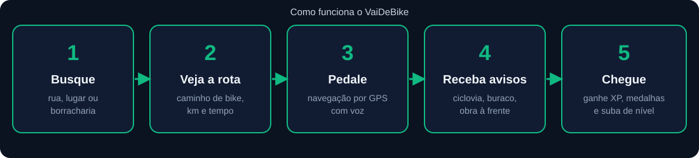
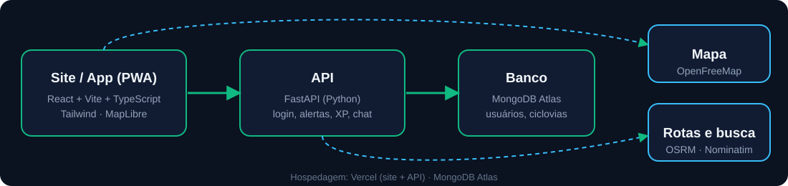

<p align="center">
  
</p>

<h1 align="center">VaiDeBike Fortaleza</h1>

<p align="center">
  Aplicativo web (PWA) de <b>segurança para ciclistas</b> em Fortaleza: rotas de bike, ciclovias e ciclofaixas,
  alertas de perigo feitos pela comunidade e gamificação para incentivar o pedal.
</p>

---

## O que o app faz

- 🗺️ **Mapa de Fortaleza** com ciclovias e ciclofaixas, em modo escuro e com prédios em 3D.
- 🔎 **Busca geral** (barra de baixo): ruas, avenidas, lugares, borracharias, ciclovias e alertas.
- 🧭 **Rota de bike e navegação por GPS**, com voz ("Em 100 metros, vire à direita"), tempo e distância.
- ⚠️ **Alertas de perigo**: buracos, obras, trechos inacabados e falta de iluminação, reportados com foto e confirmados por outros ciclistas (passam por moderação).
- 🚲 **Aviso ao entrar numa ciclovia/ciclofaixa** e **estações do Bicicletar** no mapa.
- 🔧 **Borracharias, oficinas e lojas** com avaliações.
- 🏆 **Gamificação**: XP, níveis, medalhas, missões e ranking; sons e vibração ao chegar ao destino.
- 👥 **Social**: perfil, seguir ciclistas, chat e encontros de pedal.
- 🐞 **Relatar problema do app**, direto para a equipe.

## Como funciona



## Como é feito



| Parte | Tecnologias |
|-------|-------------|
| Frontend | React 19, Vite, TypeScript, Tailwind v4, MapLibre GL |
| Backend | FastAPI (Python), Motor (MongoDB assíncrono) |
| Banco | MongoDB Atlas |
| Mapas e rotas | OpenFreeMap, OpenStreetMap (OSRM e Nominatim) |
| Hospedagem | Vercel |

## Rodar no seu computador

Pré-requisitos: Node.js 20+, Python 3.11+ e um MongoDB (local ou Atlas).

```bash
# 1) Backend  →  http://localhost:8001
cd backend
pip install -r requirements.txt
# crie backend/.env com MONGO_URL e DB_NAME (veja docs/PUBLICAR.md)
python seed.py                                   # ciclovias e dados de exemplo
uvicorn server:app --port 8001 --reload

# 2) Frontend  →  http://localhost:3000
cd frontend
npm install
npm run dev
```

O frontend chama sempre caminhos relativos `/api/...`; o servidor de desenvolvimento repassa para o backend.

**Testes:** `cd backend && pytest` · `cd frontend && npm run typecheck`

## Documentação

| Arquivo | Assunto |
|---------|---------|
| [`docs/PUBLICAR.md`](docs/PUBLICAR.md) | Publicar na Vercel + Atlas, variáveis de ambiente, recursos do app |
| [`docs/SEGURANCA.md`](docs/SEGURANCA.md) | O que foi protegido e o que ainda falta |
| [`docs/BETA.md`](docs/BETA.md) | Guia do APK beta para testadores |
| [`docs/DESENVOLVIMENTO.md`](docs/DESENVOLVIMENTO.md) | Convenções técnicas do código |

## Segurança

Senhas com PBKDF2 (600 mil voltas), sessão em cookie `httpOnly` guardada só como hash, limite de tentativas no login e nas rotas externas, CORS restrito e cabeçalhos de segurança. Para reportar uma vulnerabilidade, **não abra uma issue pública**: fale com a equipe pelo contato de suporte do projeto.

## Licença e dados

Mapas © colaboradores do [OpenStreetMap](https://www.openstreetmap.org/copyright) e [OpenFreeMap](https://openfreemap.org).
